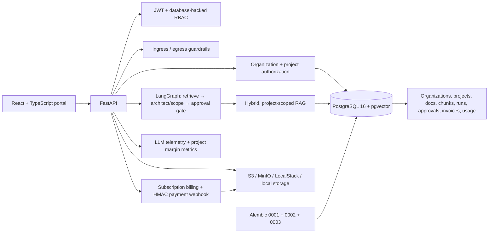

# DevOrbit AI v2.0

The workspace implements Checkpoints 1–4: tenant-scoped authentication and CRUD APIs, project-scoped document storage and RAG, AI input/output guardrails, a persistent LangGraph approval workflow, recurring invoices and payment webhooks, project FinOps metrics, a React agency/client portal, AWS Terraform modules, and CI validation.

## Architecture



Tenant ownership is checked in project/repository queries and reinforced by composite foreign keys, including document, agent-run, approval, uploader, and reviewer relationships. Client users can access only projects linked to their client record. Only staff can mark indexed documents approved; scope analysis searches only approved project documents. Passwords are Argon2-hashed, and authorization uses active database user records rather than JWT role claims.

PostgreSQL RAG combines pgvector cosine ranking and a lexical component, always filtered by `org_id` and `project_id`. SQLite tests use the same tenant filters with Python cosine/lexical scoring. Local hash embeddings are deterministic and work offline; `EMBEDDING_PROVIDER=openai` selects the optional OpenAI embedding adapter. LangGraph runs and approvals are persisted in the database. Change requests and explicit invoice-dispatch actions enter `AWAITING_APPROVAL`; resolution requires the approval's idempotency key and can safely replay the same decision.

The local workflow generates an SRS outline and milestones or classifies a request using approved project documentation. It does not call a generation LLM in this checkpoint; the embedding provider is independently configurable.

LLM usage costs are estimated from `LLM_PROVIDER_PRICING` (provider or `provider:model` keys with input/output USD per million token rates) or the default per-million rates. The deterministic local workflow reports estimated token counts with the configured provider/model labels; configure an actual LLM adapter before treating those counters as provider-billed production usage. The project margin endpoint currently uses contract budget less recorded LLM cost; it separately reports issued/paid invoice revenue and active subscription MRR.

Subscription billing tracks an explicit `next_billing_date`, emits one invoice per subscription per due date, and advances monthly/quarterly/yearly cycles. Invoice PDFs are uploaded beneath `{org_id}/{project_id}/invoices/{invoice_id}.pdf`. New active subscriptions default to a billing date of today unless one is supplied. `REQUIRE_APPROVAL_FOR_INVOICES` or `INVOICE_APPROVAL_THRESHOLD_CENTS` places invoices in the existing approval queue; approving issues the invoice, rejecting voids it. Payment webhooks require an HMAC-SHA256 `X-Signature` and the configured `PAYMENT_WEBHOOK_SECRET`.

## Checkpoint 1–4 tree

```text
devorbit-ai/
├── .gitignore
├── README.md
├── .github/
│   └── workflows/
│       └── ci-cd.yml
├── frontend/
│   ├── Dockerfile
│   ├── package.json
│   ├── package-lock.json
│   ├── nginx.conf
│   ├── vite.config.ts
│   └── src/
│       ├── App.tsx
│       ├── api.ts
│       ├── main.tsx
│       ├── styles.css
│       └── types.ts
├── backend/
│   ├── .env.example
│   ├── Dockerfile
│   ├── alembic.ini
│   ├── pyproject.toml
│   ├── alembic/
│   │   ├── env.py
│   │   ├── script.py.mako
│   │   └── versions/
│   │       ├── 0001_checkpoint_one.py
│   │       ├── 0002_checkpoint_two.py
│   │       └── 0003_checkpoint_three.py
│   ├── app/
│   │   ├── __init__.py
│   │   ├── main.py
│   │   ├── run_billing.py
│   │   ├── schemas.py
│   │   ├── ai_schemas.py
│   │   ├── finops_schemas.py
│   │   ├── api/
│   │   │   ├── __init__.py
│   │   │   └── v1/
│   │   │       ├── __init__.py
│   │   │       ├── auth.py
│   │   │       ├── clients.py
│   │   │       ├── orders.py
│   │   │       ├── subscriptions.py
│   │   │       ├── ai.py
│   │   │       ├── invoices.py
│   │   │       ├── metrics.py
│   │   │       └── router.py
│   │   ├── agent/
│   │   │   ├── __init__.py
│   │   │   ├── state.py
│   │   │   └── workflow.py
│   │   ├── core/
│   │   │   ├── __init__.py
│   │   │   ├── config.py
│   │   │   ├── dependencies.py
│   │   │   ├── guardrails.py
│   │   │   ├── logging.py
│   │   │   └── security.py
│   │   ├── db/
│   │   │   ├── __init__.py
│   │   │   ├── base.py
│   │   │   ├── models.py
│   │   │   └── session.py
│   │   ├── rag/
│   │   │   ├── __init__.py
│   │   │   ├── parser.py
│   │   │   ├── chunker.py
│   │   │   ├── embedder.py
│   │   │   ├── pgvector_store.py
│   │   │   └── retriever.py
│   │   └── services/
│   │       ├── __init__.py
│   │       ├── s3_storage.py
│   │       ├── billing_engine.py
│   │       ├── pdf_invoice.py
│   │       └── llm_telemetry.py
│   └── tests/
│       ├── conftest.py
│       ├── test_api.py
│       ├── test_ai_tenant_constraints.py
│       ├── test_guardrails_and_rag.py
│       └── test_finops_billing.py
└── infra/
    ├── docker-compose.yml
    └── terraform/
        ├── main.tf
        ├── variables.tf
        ├── outputs.tf
        ├── versions.tf
        ├── .terraform.lock.hcl
        └── modules/
            ├── network/
            ├── database/
            ├── storage/
            ├── service/
            ├── scheduler/
            └── monitoring/
```

## Local development

Requirements: Python 3.12+ and Docker Compose.

```powershell
Copy-Item backend\.env.example backend\.env
# Replace JWT_SECRET_KEY with a cryptographically random value of at least 32 characters.
docker compose -f infra\docker-compose.yml up --build
```

The frontend is available at `http://localhost:5173`, the API at `http://localhost:8000`, and OpenAPI docs at `http://localhost:8000/docs`. Compose starts the backend, frontend, PostgreSQL/pgvector, and Redis. The API container applies Alembic migrations on startup. Local Compose uses persistent Docker volumes for PostgreSQL and uploaded documents.

The Compose database defaults are for local development only. If changing the database credentials, set matching `POSTGRES_DB`, `POSTGRES_USER`, and `POSTGRES_PASSWORD` values in a root `.env` file before starting Compose. The API reads database host and credential overrides from Compose; configure `backend/.env` for secrets such as the JWT key and payment webhook secret.

For local Python development, from `backend\`:

```powershell
py -3.12 -m venv .venv
.\.venv\Scripts\Activate.ps1
python -m pip install -e ".[dev]"
Copy-Item .env.example .env
alembic upgrade head
uvicorn app.main:app --reload
pytest
```

Set `DATABASE_URL` to a reachable PostgreSQL database for local server runs. Tests use isolated in-memory SQLite databases and do not require Docker.

For frontend development outside Compose, from `frontend\`:

```powershell
npm install --legacy-peer-deps
npm run typecheck
npm run build
npm run dev
```

The Vite development server proxies `/api` to `http://localhost:8000`. In Compose it proxies to the `api` service. The production frontend image uses Nginx and proxies API requests to the backend service; terminate TLS at an HTTPS load balancer or CDN.

## APIs

- `POST /api/v1/auth/register` creates an organization and its first admin; organization slugs are unique.
- `POST /api/v1/auth/login` takes `organization_slug`, `email`, and `password`.
- `GET /api/v1/auth/me` reports the current database-backed identity.
- `POST /api/v1/auth/users` lets admins provision engineer, admin, and client users in their organization.
- `/api/v1/clients`, `/api/v1/orders`, `/api/v1/subscriptions` expose tenant-filtered list/read/create/update/delete APIs. Client users have read-only access to their own project and subscription records.
- `POST /api/v1/projects/{order_id}/documents` accepts multipart `file`, optional `title`, and staff-only `approved=true`; documents are parsed, chunked, embedded, stored, and indexed.
- `GET /api/v1/projects/{order_id}/documents/{document_id}/download` returns an authorized local download or redirects to a short-lived S3 presigned URL.
- `POST /api/v1/projects/{order_id}/rag/query` returns project-scoped answers and citations.
- `POST /api/v1/projects/{order_id}/agent/run` accepts `mode: srs|scope`; change requests and explicit `change_request_quote` / `invoice_dispatch` actions return `AWAITING_APPROVAL`.
- `GET /api/v1/approvals` lists the authenticated staff member's organization queue. `POST /api/v1/approvals/{approval_id}/resolve` takes `decision: APPROVED|REJECTED` and the matching `Idempotency-Key` header.
- `POST /api/v1/billing/run-due` runs due subscriptions for the authenticated admin's organization; optionally pass `as_of_date=YYYY-MM-DD`.
- `GET /api/v1/invoices` lists invoices scoped to the current organization or client. `GET /api/v1/invoices/{invoice_id}/download` authorizes and serves or redirects to the invoice PDF.
- `POST /api/v1/webhooks/payments` accepts a signed JSON payment event with `event_id`, `invoice_id`, and `payment_reference`.
- `GET /api/v1/projects/{order_id}/metrics` (Admin/Engineer) returns project LLM tokens/cost, average/p95 latency, contract and invoice revenue, subscription MRR, and estimated margin.
- `GET /api/v1/projects/{order_id}/documents` lists indexed documents visible to the authenticated project member.

## Storage and embedding configuration

The example environment uses `STORAGE_MODE=memory` and `EMBEDDING_PROVIDER=local`, which requires neither external service calls nor cloud credentials in tests. Choose `STORAGE_MODE=s3` with `S3_BUCKET`, optional `S3_ENDPOINT_URL`, and AWS SDK credentials/role configuration for S3, MinIO, or LocalStack. Choose `STORAGE_MODE=filesystem` and set `LOCAL_STORAGE_PATH` for local persisted files. OpenAI embeddings require `EMBEDDING_PROVIDER=openai` and `OPENAI_API_KEY`.

Set `PAYMENT_WEBHOOK_SECRET` before enabling payment callbacks. Configure pricing as JSON, e.g. `LLM_PROVIDER_PRICING={"openai":{"input_per_million_usd":0.15,"output_per_million_usd":0.60}}`. Tax is configured as a fractional `DEFAULT_TAX_RATE` (for example `0.08` for 8%). Invoice approval defaults to required; set `REQUIRE_APPROVAL_FOR_INVOICES=false` and choose a suitable high-value threshold to issue lower-value invoices directly.

All API routes except `/health`, registration, and login require a bearer access token. Public registration creates only the first admin user; subsequent users are provisioned by an organization admin.

## AWS deployment

`infra/terraform/` provisions a multi-AZ VPC (public ALB and private ECS/RDS subnets), NAT and S3 gateway routing, restrictive security groups, encrypted/versioned private S3 storage, PostgreSQL 16 with AWS-managed credentials, Secrets Manager runtime configuration, a private Fargate API service behind an ALB, EventBridge scheduled billing, and CloudWatch alarms/log retention. PostgreSQL migrations enable `pgvector`; the AWS RDS PostgreSQL engine includes the extension.

Before provisioning:

1. Build and push the backend image to ECR; use an immutable image tag or digest.
2. Create an encrypted, access-controlled remote Terraform state backend with locking. Terraform's state contains the supplied runtime secret JSON; do not use a shared or unencrypted local state for production.
3. Generate a protected, untracked `production.tfvars` file containing `backend_image` and `runtime_secret_json` (the JSON string must include `JWT_SECRET_KEY` of at least 32 characters and `PAYMENT_WEBHOOK_SECRET`). Never commit the file or place secret values in shell history. The module creates a Secrets Manager version and injects selected keys into the ECS task. RDS manages its master credential separately.
4. Configure an ACM certificate ARN and restrict `api_allowed_cidrs`; the ALB uses HTTPS with HTTP redirect when a certificate is supplied. Host the frontend image/static assets separately (for example, CloudFront + private S3 or a frontend service) and set `cors_origins` to its origin if it calls the API directly.

Example (after configuring the remote backend and protected variable file):

```powershell
Set-Location infra\terraform
terraform init
terraform fmt -check -recursive
terraform validate
terraform plan -var-file="production.tfvars"
terraform apply -var-file="production.tfvars"
```

For safe deployment, use an immutable image digest, remote encrypted state, restricted IAM for the deployment identity, and tested backup/restore procedures. The NAT gateway, multi-AZ RDS, and Fargate service incur AWS charges; the local Compose stack is the zero-cloud development option. Terraform outputs the API URL, S3 bucket, database endpoint, runtime secret ARN, and ECS cluster.

## CI and troubleshooting

GitHub Actions runs Ruff, Python bytecode compilation, the complete backend pytest suite, offline Alembic SQL generation, frontend `npm ci --legacy-peer-deps` and production typecheck/build, plus recursive Terraform formatting and validation. Run the same frontend checks locally with `npm run typecheck` and `npm run build`.

- **Compose API cannot connect to PostgreSQL:** wait for the healthy database and check that local `POSTGRES_*` overrides match; Compose configures the API host as `db`.
- **Login returns 401:** verify the workspace slug and that the account is active. Passwords require the backend's minimum length at registration.
- **Document upload fails:** check the 10 MB limit, supported text/Markdown/JSON/PDF format, and the API's storage mode/permissions.
- **Invoice PDF download is unavailable:** confirm invoice generation completed and the local storage volume or AWS task S3 role/bucket configuration is healthy.
- **Terraform ECS tasks fail to start:** check that Secrets Manager JSON contains both required keys, the execution role can read the application and RDS-managed secrets, the database security group allows task traffic, and the supplied image is accessible from private subnets.
- **Terraform reports an unsupported RDS version or instance class:** choose a PostgreSQL 16 minor version and instance type available in the selected region, then update the database module before applying.
